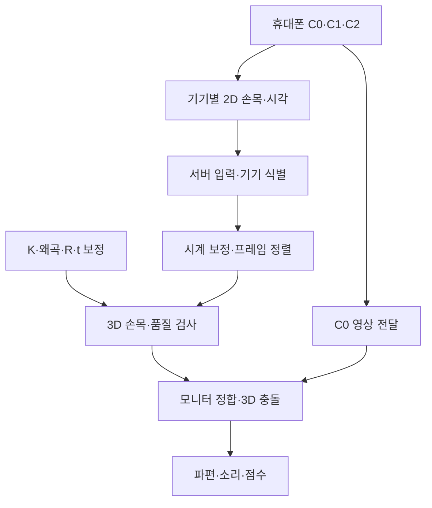

# 구조와 개발 경계

## 목표 데이터 흐름

폰 추론을 우선 검증하는 작업 가정입니다. 위 흐름은 목표 구조이며 현재 구현 완료를 뜻하지 않습니다. PC 추론을 채택하면 영상 입력·MediaPipe를 `backend/ingest/`에 연결하고 이후 공통 계약은 유지합니다.

## 폴더별 책임

| 경로 | 책임 | 경계를 지키는 규칙 |
| --- | --- | --- |
| `backend/server.py` | HTTP·WebSocket과 정적 화면 제공 | 카메라 루프나 알고리즘을 한 파일에 넣지 않음 |
| `backend/ingest/` | 기기 등록, 입력 검증, 수신, C0 영상 경로 | 미디어와 관절 큐 분리. 연결됐다는 이유로 보정 완료로 표시하지 않음 |
| `backend/calibration/` | 내부·외부 보정, 보정 버전·기기 설정 검증 | 실제 촬영 설정과 맞지 않는 보정 거부 |
| `backend/sync/` | 시계 오프셋·RTT·불확실성, 최신 프레임 정렬 | 폰 로컬 타임스탬프를 서로 바로 비교하지 않음 |
| `backend/tracking/` | 삼각측량, 재투영·깊이·신뢰도 검사 | 단일 시점과 실패 결과는 null |
| `web/camera/` | 카메라 미리보기, 이후 MediaPipe·전송 | 영상 회전·크롭·렌즈 변경을 보정 버전에 연결 |
| `web/monitor/render/` | Three.js, C0 투영, 건물 로드 | 영상과 가상 장면의 픽셀 격자·왜곡 처리 일치 |
| `web/monitor/physics/` | 손목 궤적 충돌, Rapier, 소리 | 건물 변환을 렌더링과 공유하고 추적 실패 시 궤적 초기화 |
| `web/monitor/game/` | 준비, 시작, 60초, 점수, 결과, 리셋 | UI가 관절의 유효 여부를 임의로 바꾸지 않음 |

초기에는 폴더마다 역할 안내를 두었습니다. 아직 구현하지 않은 알고리즘에 성공처럼 동작하는 가짜 함수를 넣지 않았습니다.

## 현재 실행되는 흐름

1. FastAPI가 `/monitor/`와 `/camera/`를 제공합니다. 접속 키를 설정하면 모든 요청에 키가 필요합니다(D07).
2. 두 화면이 `/ws/status`로 서버 상태를 받습니다. 상태는 실제 등록·관절 수신·보정·추적 기준으로 계산합니다.
3. 서버는 `/ws/ingest`에서 휴대폰 등록, 시계 교환, `pose_2d` 검증·수신을 처리하고, 보정·시각 조건을 만족한 관측을 정렬해 `/ws/pose3d`로 `pose_3d`를 보냅니다.
4. 카메라 페이지는 아직 로컬 미리보기만 하며 `/ws/ingest`로 송신하지 않습니다(김태이 연결 예정). 모니터도 `pose_3d`를 아직 받지 않습니다(이동수 연결 예정).
5. 실측 보정 파일이 없으므로 보정·추적 준비와 `game_ready`는 false입니다. 합성 보정으로는 준비 상태가 true가 되지 않습니다.

## 좌표와 시간

- 월드 좌표: 바닥 기준 원점, X/Y는 바닥, Z는 위, m 단위.
- OpenCV 카메라: +x 오른쪽, +y 아래, +z 전방.
- Three.js 표시 변환: `(X,Y,Z) → (X,Z,-Y)`. 위치와 카메라 외부 파라미터에 같은 기준을 적용합니다.
- 관절 추출 결과는 원본 영상 크기 기준 픽셀입니다. MediaPipe의 정규화 좌표는 원본 폭·높이로 변환합니다.
- 2D 관절은 원본/왜곡 보정 좌표 중 어느 쪽인지 명시합니다. 왜곡을 두 번 제거하지 않습니다.
- 촬영 시각, 추론 종료 시각, 서버 수신 시각은 별도 값입니다. 시간 단위는 ms이며 시계 기준을 필드로 명시합니다.

## C0 영상과 관절을 따로 다루기

관절 메시지만 전송해도 3D 계산은 가능하지만, 모니터에 사용자 모습을 합성하려면 C0 영상 전달 경로가 추가로 필요합니다. C1/C2의 영상 생략 가능 여부를 C0에도 그대로 적용하지 않습니다. 영상 전송 방식은 실제 지연·기기 호환성을 측정해 정합니다.

## 의존성 추가 시점

현재 화면은 HTML/CSS/JavaScript 모듈만 사용해 별도 Node 빌드가 없습니다. T02에서 MediaPipe 웹 패키지, T04에서 Three.js·Rapier를 도입할 때 패키지 관리자와 잠금 파일을 함께 커밋합니다. 서버의 시간 정렬·3D 복원 기초에 필요해 OpenCV(`opencv-python-headless==4.13.0.92`)·NumPy(`2.4.4`)를 앞당겨 추가했습니다(Python 3.12에서 확인). 모델·WASM·필수 에셋은 시연 전에 로컬 제공 경로를 준비합니다.
