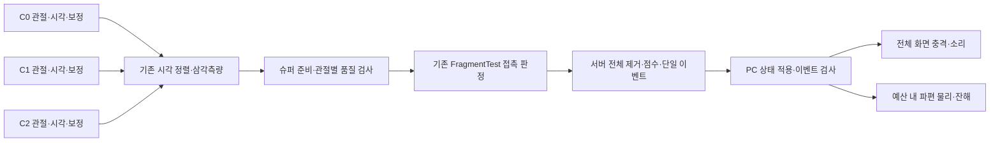
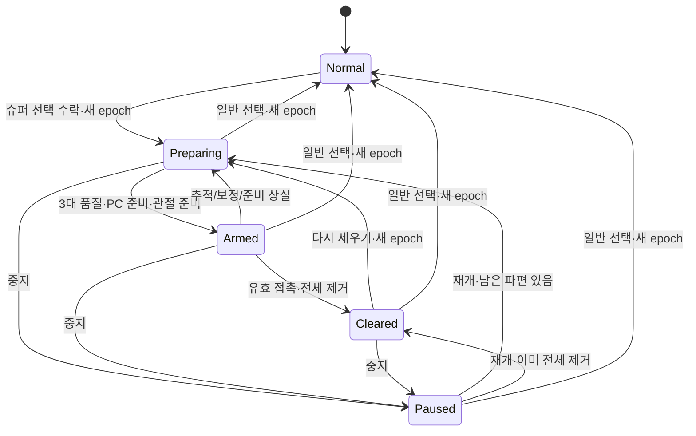

# 3대 삼각측량 전용 연쇄 폭파 상세 설계

기준: 2026-11-21, Asia/Seoul. 설계 v0.3(접촉점 폭발 개선), 구현 시작 기준 main `d2674c0`. 후속 요청으로 `feat/super-smash-three-camera`에 SS-01~03을 구현했다. **아래 숫자는 설계 기준이며 실제3대/성능 인수는 미검증이다.** 현재 구현/검증 범위는 [실행·인수 안내](SUPER_SMASH_TEST.md)와 PM 최신 기록을 따른다. C0·C1·C2 삼각측량만 만들며 이전 네 모드 공용/duo 우선 제안은 철회했다. 이전 기록은 보존한다.

## 1. 만들 결과와 첫 버전의 결정

실제 손목/발목이 현재 건물에 유효하게 닿으면 **접촉점의 섬광/화염에서 충격파·불꽃·콘크리트 조각·먼지가 퍼지는 약2.1초 연출**을 보여준다. 현재 장면 전체 제거·점수는 한 번에 확정하고 파편 표시는 실제로 맞은 조각부터 시작해 거리 순서로0~650ms 방출을 예약한다. 프레임 작업 한도에 따라 실행은 다음 프레임으로 넘어갈 수 있다. 이후 잔해와 이번 파괴 점수를 표시한다. 운영자가 복원하면 같은 장면에서 다시 칠 수 있다.

| 항목 | 이번 설계의 기본안 |
| --- | --- |
| 적용 경로 | `/test/building/`의 기본 3대 삼각측량, `source=multi_view_test` |
| 입력 | 기존 `/test/multi3d/`의 C0·C1·C2. 각 폰은 관절/보정/시각과 기존 영상 경로를 제공 |
| 모드 | 일반 파괴 / 연쇄 폭파. 내부 값 super_smash는 호환 유지, 효과명 문구는 화면에 그리지 않음 |
| 발동 | 기존 3D 접촉 판정에 새 준비 조건을 더함. 별도 제스처·충전·세기 등급 없음 |
| 파괴 범위 | 서버가 현재 로드한 `scene_id`의 남은 고유 파편 전체. 단독 IT1이면 한 건물, 소구역이면 그 구역 전체 |
| 점수 | 새로 제거한 파편당 1점. 전체 제거 전후 집합 차이와 정확히 일치 |
| 화면 | C0를 크게 보는 플레이 화면 + 세 카메라/품질을 보는 운영 화면. C0 자동 교체 없음 |
| 반복 | 첫 버전 수동 복원. 자동 다음 건물·자동 복원·60초 경쟁 게임은 연결하지 않음 |
| 콘텐츠 | 독자적인 만화식 충격 컷·속도선·충격 고리·먼지·파편. 기존 건물 에셋 재사용 |
| 후속 | 충전/콤보·지면 전체 파동·자동 반복·새 3D 캐릭터/필살기 영상은 별도 확장 |

실제 요구 근거는 첨부 대화의 “화면 전체를 채움”, “한 방에 건물 전체”, “사람/배경도 덮음”, “별도 스트레스 해소 모드”와 이번 3대 전용 지시다. 2.1초·색/물리 예산·준비 시간은 구현을 위한 설계 기본값이며 사용자의 실측 결과나 팀 합의로 간주하지 않는다. PC 연출로 기존 입력 지연이 해결됐다고 주장하지 않는다.

mono/wide/duo용 슈퍼 UI·서버 명령·전용 에셋은 만들지 않는다. 공용 파편 코드에 정책을 추가하더라도 기본은 기존 동작이며 **multi3d 허브만 명시적으로 슈퍼 정책을 주입**한다. 공용 코드 변경의 기존 소비자 회귀는 필요하다.

## 2. 설치·실행·운영 흐름

### 2.1 카메라와 좌표

- 세 폰은 동일한 바닥 ArUco ID0와 동일한 실제 마커 한 변을 사용한다. 마커 원점·축·미터 단위는 [기존 3대 시험](MULTI3D_TEST.md)을 유지한다. 가로로 ID0/1/2를 나열하는 wide 배치와 다르다.
- C0는 플레이 화면에 쓸 전면/사선 시점, C1·C2는 같은 활동 공간을 다른 각도로 본다. 기존 안내의 사람 기준 60~120° 배치를 출발점으로 하며 거의 평행/정반대 광선은 피한다. 최종 위치는 현장 정합 시험으로 결정한다.
- 세 폰 모두 손/발과 건물 영역을 충분히 보도록 고정한다. 영상 회전·해상도·렌즈·카메라 위치가 바뀌면 해당 보정을 무효화한다. 효과 카메라 흔들기로 실제 K/R/t나 판정 좌표를 변경하지 않는다.
- 기존 최신 정책대로 **3대는 필수 몸 보정 단계를 새로 만들지 않는다.** 현재 고정 placement/scale을 사용한다. 운영자가 기존 몸 보정을 선택했다면 그 보정이 끝나야 하며 저장된 기준은 복원 때 유지한다. 옛 문서의 몸 보정 필수 설명보다 실제 `body_required` 상태와 최신 정책을 우선한다.

### 2.2 운영자가 누르는 순서

1. 기존 서버 실행 후 폰마다 `/test/multi3d/?camera=C0`, `C1`, `C2`를 열고 접속키·마커/높이·보정 축을 확인한다. 키는 기존 접속 방식으로 전달하며 로그에 남기지 않는다.
2. PC에서 `/test/building/?scene=it1`로 한 건물 정합/파괴를 먼저 확인한다. 이미 사용 중인 공유 허브라면 URL만으로 초기화됐다고 가정하지 않고 서버 `scene_id=it1`을 확인한다. 소구역 검증은 `/test/building/`에서 별도로 진행한다. 이 URL은 기존 경로이며 슈퍼는 새 UI를 구현한 뒤 선택한다.
3. 운영 화면에서 C0/C1/C2 연결·유효 보정·시각 정렬과 건물/마커 정합을 확인한다. `플레이 화면`은 C0 영상과 같은 투영의 건물만 크게 보여준다. 중앙 궤도 3D는 운영 진단용이다.
4. `연쇄 폭파` 선택 → 서버 수락/새 epoch → `준비 중` → 조건 충족 후 `한 번 쳐 보세요`. 클라이언트가 선택만으로 준비 완료를 표시하지 않는다.
5. 정상 접촉 1회 → 전체 파괴/연출 → `전체 파괴 · +N점` → `다시 세우기`. 복원 수락 후 손/발이 대상 밖에서 다시 관측되어야 재준비한다.

새 PC UI: 모드 선택, 플레이 화면 전환, 이번 파편 점수, 준비/중단 사유, 다시 세우기, 효과 미리보기, 음소거, 동작 줄이기, 중지/재개. 슈퍼에서는 기존 반경·지지 붕괴·자동 다음·마우스 파괴 설정을 잠그고 이유를 표시한다. 일반 설정은 서버에 보관해 일반으로 돌아올 때 복구한다.

`중지`는 화면을 즉시 취소하고 해당 PC에서 소리를 멈춘 뒤 **서버 판정 중지 명령도 전송**한다. 응답 전에는 `중지 요청 중`, 응답 후 `중지됨`으로 구분한다. 네트워크 단절 시 해당 PC는 즉시 중단하되 서버 중지를 확인했다고 표시하지 않는다. `재개`는 남은 파편/점수를 유지하고 궤적·준비 조건만 다시 확보한다.

## 3. 데이터 흐름과 판정 권한



서버가 타격 수락·제거 ID·점수·모드·라운드를 결정한다. PC는 서버 이벤트를 시각화하며 점수/파괴를 선행 확정하지 않는다. 폰은 이펙트와 파편을 렌더링하지 않는다.

`multi3d_fused` 최상위 `hits/hit`는 옛 상자 판정이다. 슈퍼는 **`model_test.event`만** 소비한다. 최상위 `valid`도 손목 존재 기준이므로 발목 이벤트의 수락 여부를 대신할 수 없다. 충돌 관절의 `cams`·품질과 서버 수락 결과를 사용한다. `cameras_used`는 시각 정렬에 선택된 카메라 집합이며 특정 관절에 실제 쓰인 카메라와 다를 수 있다.

## 4. 3대 준비·무효 입력·재준비 조건

**장비는 세 대 모두 동작해야 하고, 관절은 유효한 두 시점 이상으로 계산한다.** 한 폰에서 손이 잠깐 가려져도 다른 두 폰이 충분한 기하/시각 품질로 같은 손을 보면 허용한다. 카메라 한 대가 끊긴 상태로 2대 운영을 계속하는 기능은 이번 범위에 없다.

| 단계 | 조건·기준 | 실패 시 동작 |
| --- | --- | --- |
| 장비 | C0/C1/C2 등록·현재 연결 세대의 보정 유효·각 최신 관절 프레임 수신 나이 ≤400ms | 슈퍼 판정 일시 중단, 모든 이전 관절 궤적/준비 해제 |
| 시각 | 세 폰 모두 시계 교환 완료·불확실성 ≤10ms. `inference_input_aligned`와 기존 nearest 30ms 및 spread+불확실성 ≤40ms 유지 | 세 폰의 시계 미준비는 전역 중단. 개별 정렬에서 제외된 시점은 쓰지 않으며 최소 두 시점이 필요 |
| 개별 관절 | 기존 visibility ≥0.5, 유한 좌표·관절별 `cams` ≥2, 광선 각도 ≥5°, 재투영 오차 ≤짧은 변/720×8px | 그 관절 무효, 이전점/관절별 준비 삭제. 다른 유효 관절은 계속 가능 |
| 모호성 | 기존 `ambiguous_views`·`poor_geometry`·`reprojection_error` 거부 유지 | 낮은 신뢰 관절/가상 좌표로 대체하지 않음 |
| 전역 안정 | 같은 카메라/보정 세대에서 위 장비/시각 기반 조건 300ms 연속 만족 | 중간 실패 시 안정 시간 다시 시작 |
| 관절별 준비 | 타격에 쓸 손목/발목이 현재 활성 충돌체 밖 5cm 여유에서 유효하게 ≥2표본, ≥100ms 관측 | 대상 안에서 첫 검출/복원되면 대기. 해당 관절은 밖으로 빼야 함 |
| 연속 궤적 | 같은 관절의 기존 두 유효점, `0 < dt ≤250ms`, 점 간 이동 ≤1.5m | 복구 첫점은 기준만 갱신, 그 선분으로 타격하지 않음 |
| 모델/PC | 서버·운영 PC 장면/물리/필수 시각 에셋 준비, 같은 epoch | 판정 중지 또는 재준비. PC 준비 임대는 아래 참고 |

300ms/100ms/5cm는 새 슈퍼 전용 준비 기본값이다. 400ms·시각/관절 품질·250ms/1.5m는 현 코드의 기준을 인용했다. 구현 시 경계값 시험을 하고 임의로 완화하지 않는다. `server_arrival` 호환 입력은 진단 표시만 하고 슈퍼 실타격 준비를 허용하지 않는다. 합성 시험은 정렬된 시각/품질을 갖춘 명시적 시험 세션으로 구분한다.

관절별 준비 완료 후에는 기존 빠른 겹침 접촉도 허용한다. 슈퍼를 쉽게 발동시키려고 손목에 일괄 새 속도 문턱을 넣지 않는다. 기존의 느린 내부 이동 거부, 서 있는 상태의 빠른 동작 예외(1.5m/s·8cm), 발목의 높이0.20m·속도1.5m/s 조건을 유지한다. 표시용 몸통/사람 깊이·과거 좌표·보간 좌표는 타격 입력으로 쓰지 않는다.

미검출뿐 아니라 dt/jump 단절도 해당 관절의 준비를 해제한다. 다른 준비된 관절이 없으면 preparing으로 돌아가며, 끊긴 관절은 밖에서 다시 준비해야 한다. 타격 후보의 직전/현재점은 모두 같은 보정 세대의 유효한 실제 추정점이어야 한다.

C0 영상 자체는 관절의 시각과 별개다. 운영 PC의 C0 표시가 500ms 넘게 갱신되지 않거나 페이지가 숨겨지면 판정 중지 요청·로컬 연출 차단을 한다. 이 500ms는 새 표시 목표값이다. C0를 C1으로 몰래 바꾸거나 오래된 영상 위에 새 타격을 보여주지 않는다. 복구 후 다시 준비한다.

운영 PC는 서버에 `viewer_id`와 현재 epoch의 `presentation_ready`를 보낸다. 서버는 명시적으로 선택된 운영 PC 한 곳의 준비 임대를 사용한다(1초마다 갱신, 3초 만료 기본값). 숨김/장면 로딩/모델 실패는 즉시 false로 보내고, 만료 시 판정을 중지한다. 추가 PC는 관찰자로 상태를 받으며 관찰자의 실패는 라운드를 멈추지 않는다. 운영 PC 교체는 명시적으로만 한다. 이 임대는 전송 실패를 즉시 탐지하는 보장이 아니며 그 사이 수락된 상태는 서버가 보존한다.

카메라 재접속/보정값 변경은 서버가 `calibration_version`을 올리고 모든 궤적·준비를 비운다. 현재 연결에 유효한 보정을 다시 확인하기 전 옛 보정을 수락하지 않는다. 파편/점수는 유지하며 placement/scale/장면을 바꿀 때만 새 라운드로 초기화한다.

## 5. 서버 전체 파괴·점수·상태 규칙

### 5.1 파괴는 한 번의 원자적 전이

1. 기존 `FragmentTest.update()`가 관절별 준비를 통과한 입력으로 정상 접촉 후보를 고른다. 두 손/발 동시 접촉도 기존 가장 이른 후보 하나만 택한다.
2. `normal`이면 기존 부분 파괴를 그대로 실행한다. `super_smash`면 접촉점·맞은 파편·관절·입력 근거를 보존하고 남은 전체 ID를 `release()`에 한 번 전달한다.
3. `new_ids = all_ids - removed_before`, `removed_after = all_ids`, `points = len(new_ids)`, `score_after = len(removed_after)`를 한 전이에서 확정한다. `new_ids`가 비면 이벤트·점수·소리 없음.
4. 새 `event_id` 하나와 새 revision을 발행한다. `released_ids`는 `new_ids` 전체이고, 전체 직접 제거이므로 새 지지 상실 ID는 없다. 파편마다 이벤트를 보내지 않는다.
5. 상태를 `cleared`로 둔다. 남은 타격/늦은 프레임은 추가 파괴·득점·연출을 만들지 않는다. 같은 epoch는 한 번의 슈퍼 발동만 허용한다.

예: 총96개 중 일반에서20개가 이미 제거된 저장 상태를 별도 시험으로 주입하면 슈퍼 추가 점수는76, 최종 점수96이다. 실제 모드 전환은 새 라운드를 만들므로 일반에서 슈퍼로 전환하며 점수를 이어 붙이지 않는다.

`drop_all`을 실타격 명령으로 재사용하거나 폭발 반경을 크게 만들어 전체 파괴를 흉내 내지 않는다. `mouse_hit/strike`도 같은 공용 함수를 사용할 수 있으므로 **전체 파괴 정책은 수락된 관절 접촉 경로에만 전달**한다. 마우스·키보드·지지 붕괴·합성 낙하가 슈퍼 실타격으로 승격되면 안 된다.

### 5.2 상태와 전환



| 조작/사건 | 파편·점수·epoch | PC/추적 처리 |
| --- | --- | --- |
| 모드 실제 변경 | 복원/0점/새 epoch, 일반 설정은 별도 보존 | 효과·소리·물리 작업 취소, 전 관절 기준/준비 삭제 |
| 같은 모드 재선택 | no-op, epoch/점수 유지 | 새 타격/효과 없음 |
| 다시 세우기 | 같은 장면·placement 유지, 복원/0점/새 epoch | 모델/물리 복원 후 밖에서 재준비 |
| 중지/재개 | 점수/제거 집합·epoch 유지 | 중지 즉시 표시 취소, 재개 시 궤적·준비만 초기화 |
| 장면/placement 변경 | 운영 조작으로만 새 epoch/0점, 크기 자동 추종 없음 | 로딩 중 판정 중지, 옛 로더/물리 작업 세대 폐기 |
| 폰/PC 연결·보정 실패 | 상태 보존, 품질 상실/중지 | 옛 선분 연결 금지, 재연결 snapshot 무연출 |
| 서버 재시작 | 새 server_instance_id, 초기 일반/새 epoch | 옛 인스턴스 패킷·소리·작업 폐기 |

타격·모드·복원·중지를 multi3d 허브의 같은 직렬 처리 경계에서 확정한다. 비동기 기하/에셋 결과는 시작 때의 instance/epoch/scene/calibration_version을 확인한 뒤 반영한다. 실제로 존재하지 않는 worker 구조를 전제하지 않으며 도입한다면 같은 세대 검사를 적용한다.

## 6. 화면 연출: 접촉점부터 터지는 2.1초

2026-11-21 사용자 후속 지시로 큰 SUPER SMASH 문구·중앙 타이틀 카드·즉시 전체 불투명 컷을 제거했다. 사용자 표시명은 **연쇄 폭파**다. 아래 타임라인은 기존1.2초 컷을 대체한다. 내부 모드/이벤트 이름은 호환 유지한다.

기준 t0는 PC의 유효 이벤트 수신 performance.now다. 카메라/추론/서버 시각은 멈추지 않는다. Canvas는 접촉점만 먼저 밝히므로 타격 부위와 주변 건물을 볼 수 있다.

| 경과 | 화면/물리 | 소리 |
| --- | --- | --- |
| 0~80ms | 서버 point_m을 C0 K/R/t와 화면 비율로 투영한 위치에 백열 섬광/작은 화염 발생. 먼 화면 구석은 투명 | 저역 폭발·짧은 폭발 잡음 |
| 80~300ms | 불규칙 화염 덩어리가 접촉점 주변에서 커지고 방사 불꽃·타원 충격파 확산 | 첫 붕괴음이 약140ms부터 겹침 |
| 0~650ms | 가까운 파편부터 거리 순서로 방출, 먼 파편은 파동 도착 전까지 원래 모습. 논리 제거/점수는 이미 전체 확정 | 310/490/700ms 등의 둔탁한 충돌음 |
| 300~1500ms | 최대32개 불꽃·16개 콘크리트 조각이 날고 굵은 연기16덩어리가 위/바깥으로 퍼짐 | 붕괴 잡음3층·둔탁한 충돌5회·잔해/딸깍4회, 총14 source 이하 |
| 1500~2100ms | 연기/잔해가 사라지며 실제 AR 장면과 전체 파괴 결과가 보임 | 마지막 잔해음 감쇠, 늦은 재생 없음 |
| 2100~4000ms | 남은 실제3D 파편은 물리로 움직이다4초 한도에서 정리. 수동 복원 대기 | 새 소리 추가 없음 |

레이어는 기존 C0 영상/정합 건물·사람 가림 → 폭발 Canvas → 운영/중지·음소거다. Canvas는 viewport 전체를 쓸 수 있지만 처음부터 전체 배경/사람을 가리지 않는다. 큰 효과명 글자는 그리지 않는다. 새로운 캐릭터/영상/외부 소리 에셋은 없다.

접촉점은 placement를 다시 곱하지 않고 기존 marker 미터 좌표를 C0 카메라로 투영한다. 실제 이벤트 로그에 point_m/originPx를 남기고 브라우저 검사에서 독립 K/R/t 계산과 대조한다. 화면 밖/뒤 접촉만 기존 중앙 대체를 사용하며 실제 물리 접촉점/방향은 유지한다.

미리보기는 보정된 카메라가 있으면 현재 건물 중심, 없으면 화면 중앙을 사용한다. 진단 API previewImpact([x,y])로 임의의 화면 지점에서 무득점 효과를 확인할 수 있다. 실제 타격은 항상 서버 contact point를 쓴다.

음소거/중지/복원/숨김은 예약된 잔해음까지 취소한다. 동작 줄이기/OS reduced-motion은 비산·충격파 대신 접촉점의 잔잔한 주황빛 페이드만 사용한다. 재접속은 과거 효과를 재생하지 않는다.

## 7. 파편 물리와 소리의 구체적 처리

서버 논리 제거와 PC 시각 물리를 분리한다. 모든 ID는 즉시 제거 상태/점수에 반영하고, 물리 계산을 늦추더라도 새 충돌 대상으로 남겨 두지 않는다. 화면 효과 첫 draw를 먼저 예약한 뒤 접촉점 거리에 따라 0~650ms 시각 방출 시간을 정하고, 프레임별 동적 몸체 해제를 분산한다. 먼 파편은 방출 시각까지 시각적으로만 남고 충돌/득점 대상은 아니다. 현재 `syncState()`는 곧바로 `physics.release()`를 하므로 단순히 마지막에 Canvas 호출을 붙이면 첫 draw가 늦어진다.

| 자원 | 초기 예산/정책 | 초과·실패 처리 |
| --- | --- | --- |
| 동적 Rapier 몸체 | 동시에128개 이내, 프레임당 최대16개 및 준비 작업3ms 중 먼저 닿는 한도 | 나머지는 제거 처리 후 간단한 GPU 이동/먼지로 표시. 파괴/점수 누락 없음 |
| 장식 | 불꽃32+콘크리트16, 연기16, 폭발1개 | 사전 생성/시간 기반 수명, 2.1초에 정리 |
| 화면 Canvas | DPR 상한1.5, 긴 변1920px 이하의 내부 해상도 | CSS로 viewport 채움, 저사양에서 장식/내부 해상도 축소 |
| 파편 이동 | 접촉 이동 방향+각 파편의 접촉점 반대 방향+위쪽 성분 | 0벡터는 방사/위쪽 사용. 속도24m/s·각속도25rad/s 기존 상한을 넘지 않음 |
| 바닥/충돌 | 기존 바닥 유지, 슈퍼 파편끼리의 연쇄 재타격/점수 전송 차단 | 현재 클라이언트 2차 `model_release` 전송 경로도 슈퍼에서는 차단 |
| 수명 | 최대4초 후 정적 잔해 또는 숨김. 복원 시 초기 모델 재사용 | epoch 변경 시 모든 예약/이전 물리 폐기, 새 장면에 재적용 금지 |

전체 파편 방향은 렌더러가 `event_id + fragment_id` 기반으로 결정해 재현 가능하게 한다. 128개를 넘는 장면의 대표 물리 조각은 접촉점 거리와 ID로 안정적으로 선택한다. 화면 밖 조각을 무작정 먼저 생성하지 않는다. 예정된 방출 시각까지 준비가 끝나지 않으면 그 조각은 간단한 표시 대체를 사용하며 연출을 무한 대기시키지 않는다.

오디오 소유자는 PC 효과 어댑터 하나다. 같은 event_id에 충격·붕괴·잔해 프리셋을 한 번 예약하고 기존 일반 소리 경로를 함께 호출하지 않는다. 기존 `createArHitSound().observeFrame()`는 상자 `hits` 카운터 소비자이므로 파편 `score`를 넣지 않는다. 필요한 하위 소리 API를 재사용하되 단일 AudioContext/사용자 제스처 해제·음소거 정책을 보존한다. 첫 버전 합성/사전 로드 소리로 시작하며 실제 음량/청취 결과는 현장에서 따로 검증한다.

## 8. 새 메시지 계약 초안

이 절의 제어·상태/이벤트 타입을 multi3d 허브에 구현했다. 테스트 전용 경로이며 `/ws/pose` 계약은 바꾸지 않는다. [DATA_CONTRACT](DATA_CONTRACT.md)·[MODEL_STRIKE_3D](MODEL_STRIKE_3D.md)·[실행·인수 안내](SUPER_SMASH_TEST.md)와 송수신 테스트를 함께 따른다.

### 8.1 제어 명령과 응답

새 제어 명령은 인증된 viewer가 multi3d 허브에만 보낸다. 모드/복원/중지/재개/장면 조작은 같은 envelope를 사용한다.

```json
{
  "type": "multi3d_model_control",
  "request_id": "cmd-001",
  "server_instance_id": "server-a",
  "expected_epoch": "round-a",
  "expected_control_revision": 4,
  "action": "set_mode",
  "mode": "super_smash"
}
```

`action`: `set_mode`, `reset`, `pause`, `resume`, `set_scene`, `claim_controller`, `handoff_controller`. `set_scene`만 `scene_id`, `handoff_controller`만 대상 `viewer_id`를 받는다. claim은 현재 운영자가 없거나 임대가 만료된 경우에만 허용하고 동시 claim은 한 요청만 수락한다. 등록/인계도 control_revision을 증가시킨다. 알 수 없는 action/모드·잘못된 필드·범위는 거부한다. `control_revision`은 제어 변경 때만 증가하므로 고주기 관절 프레임 때문에 정상 버튼이 계속 stale 처리되지 않는다. 상태/이벤트 전달 순서는 별도의 `model_revision`을 쓴다.

```json
{
  "type": "multi3d_model_control_ack",
  "request_id": "cmd-001",
  "accepted": true,
  "code": "ok",
  "server_instance_id": "server-a",
  "epoch": "round-b",
  "control_revision": 5,
  "model_revision": 42,
  "smash_mode": "super_smash",
  "phase": "preparing"
}
```

수락 시 ack와 같은 revision의 완전한 `model_state`를 보낸다. UI는 해당 상태를 적용한 뒤 선택을 확정한다. 버튼 pending 동안 연타를 막고 2초 무응답이면 `응답 확인 중`으로 표시하며 snapshot을 요청한다. 동일 소켓은 같은 request_id로 재시도할 수 있다. 재접속 후에는 snapshot을 먼저 받고 사용자 조작 없이 새 request_id로 파괴적 명령을 재발행하지 않는다.

중복 `(viewer 연결 세션, request_id)`는 최초 ack를 반환하고 다시 실행하지 않는다. 최근128개 응답을 저장하고 연결 종료 때 회수한다. 오래된 요청도 expected epoch/control_revision 검사를 다시 적용한다. 거부 코드는 stale_instance/stale_epoch/stale_control_revision/invalid_command/not_controller이며 알 수 없는 모드도 invalid_command다. 잘못된 request_id/메시지는 기존 bad_message다. 현재 상태를 다시 제공한다.

같은 허브의 모드/점수는 모든 viewer가 공유하며 room-1/room-2 게임 상태와 같지 않다. 일반 인증과 별도로 운영 PC `viewer_id` 한 곳만 새 제어/준비 임대를 소유한다. 첫 운영 PC를 명시 등록하고, 교체는 기존 운영자가 넘기거나 연결 임대가 끝난 뒤 명시적으로 선택한다. 관찰자는 명령을 보내도 `not_controller`다. 공유 접속키 자체를 개인별 권한으로 오인하지 않는다.

연결 때 서버가 소켓에 `viewer_id`를 부여한다. 운영 PC의 `multi3d_presentation` 메시지는 현재 `server_instance_id`, `epoch`, `presentation_ready`, `c0_frame_age_ms`, `visible`, `assets_ready`를 포함한다. 서버는 등록 소켓의 소유권·세대·유한한 프레임 나이를 검사하고 준비 임대를 갱신한다. 오래된 epoch의 heartbeat는 새 라운드를 준비 상태로 만들지 못한다. 연결 직후/모델 로딩 중에는 false이며 운영 PC가 준비 완료를 새 epoch로 보고한 뒤에만 판정한다. 관찰자의 갱신으로 운영자의 임대를 연장하지 않는다.

슈퍼 동작 중 기존 `model_mouse/push/release/drop_all/config/collapse/blast_config`는 거부한다. 기존 reset/scene 같은 경로도 새 제어 검사로 우회 불가하게 막고 새 envelope로 안내한다. 일반 모드의 기존 호환 동작은 유지한다. 공용 함수에 타입 문자열이 같다는 이유로 다른 허브가 이 명령을 수락하지 않게 한다.

### 8.2 snapshot과 타격 이벤트

기존 `model_test`에 다음 필드를 추가한다. 기존 필드는 삭제/의미 변경하지 않는다.

| 필드 | 의미/소유 |
| --- | --- |
| `server_instance_id` | 허브를 포함한 서버 실행 세대. 재시작 시 새 값 |
| `epoch`, `scene_id` | 기존 라운드/장면. reset/모드 실제 변경/장면 변경 시 새 epoch |
| `model_revision` | 허브에서 발행하는 모델 snapshot/이벤트의 순서. epoch/모델 재구축을 넘어 단조 증가 |
| `control_revision` | 제어 변경 순서. 관절만 갱신된 프레임은 증가시키지 않음 |
| `calibration_version` | 보정/폰 연결 세대. 전환 전 관절 선분을 이어 쓰지 않는 근거 |
| `smash_mode`, `phase` | `normal` 또는 `super_smash`; 슈퍼의 preparing/armed/cleared/paused |
| `controller_viewer_id`, `readiness` | 운영 PC 식별자와 ready 여부·사유 코드·관절별 준비·세 카메라 상태·PC 준비, 서버 소유 |
| `removed_ids`, `score`, `event` | 기존 전체 상태·고유 파편 점수·이번 이벤트 |

아래는 총3개 파편인 시험 장면에서의 이벤트 예다. 실제 장면은 해당 고유 ID 전체를 담는다.

```json
{
  "event_id": "impact-a",
  "server_instance_id": "server-a",
  "epoch": "round-b",
  "model_revision": 58,
  "scene_id": "fixture-three-fragments",
  "smash_mode": "super_smash",
  "effect_style": "screen_impact_v1",
  "kind": "wrist",
  "joint": "right_wrist",
  "fragment_id": 2,
  "released_ids": [1, 2, 3],
  "unsupported_ids": [],
  "points": 3,
  "point_m": [0.1, 0.05, 0.6],
  "direction": [0.8, 0.2, 0.3],
  "tracking_source": "multi_view_test",
  "input_mode": "synthetic",
  "calibration_version": 7,
  "input_reference_ms": 12000,
  "joint_cameras": ["C0", "C2"]
}
```

`tracking_source`는 계산 방식, `input_mode`는 입력 출처로 별개다. live/synthetic/replay/keyboard_demo/mouse_demo/unknown을 섞지 않는다. 세션/시험 어댑터에서 출처를 설정하고 이벤트로 상속하며 증명할 수 없으면 unknown이다. 폰 프로토콜에 live라고 표시됐다는 것만으로 실제 사람 시험을 했다고 기록하지 않는다. 합성/재생 서버 시험을 허용할 때는 운영 화면에 출처 배지를 계속 표시한다. 마우스/키보드/unknown은 슈퍼 실타격 경로에 넣지 않는다.

### 8.3 PC 수신 순서와 재접속

1. 접속 시 서버는 `delivery=snapshot`, `event=null`인 완전한 상태를 먼저 보낸다. 초기 상태/이미 cleared인 상태는 파편·점수만 복원하고 과거 연출/소리는 재생하지 않는다.
2. PC는 instance를 먼저 확인하고, 같은 instance에서 `model_revision`이 작은 패킷은 전부 버린다. 같은 revision의 ack/state 중복은 상태를 두 번 초기화하지 않는다. epoch UUID의 문자열 크기로 순서를 판단하지 않는다.
3. 라이브 타격 전달은 `delivery=event`, 일반적인 후속 상태/관절 갱신은 `delivery=update`로 표시한다. 한 socket의 WebSocket 전송 순서를 유지하고 이벤트를 뒤의 무이벤트 상태로 덮어 보내지 않는다. 이벤트는 latest-only 큐에 넣지 않는다. 놓쳤으면 재동기화 snapshot으로 결과만 복구하며 과거 효과를 뒤늦게 재연하지 않는다.
4. 새 event는 서버 권위 상태·현재 scene/epoch·허용된 출처·명시적 `effect_style`·운영 화면 준비가 맞을 때만 실행한다. bounded event_id 기억256개와 revision으로 중복을 막는다. 상태를 먼저 적용한 새 epoch의 같은 패킷 이벤트는 정상 처리한다.
5. 효과 대기열은 만들지 않는다. 이 모드는 epoch당 한 이벤트다. 초기/재동기화 snapshot·중지·리셋·새 장면/epoch·server instance 변경·페이지 숨김·연결 상실은 효과/소리/이전 물리 예약을 취소한다. 같은 epoch의 일반 `delivery=update`는 진행 중 연출을 취소/재시작하지 않는다.

server timestamp만으로 늦은 이벤트를 판별하지 않는다. PC 로컬 수신 후 100ms 넘게 메인 스레드가 막혀 첫 draw를 못 한 경우 논리 결과는 유지하고 긴 연출은 건너뛴 뒤 지연을 로그에 남긴다. 이 정책은 네트워크 이전 지연을 제거하지 않으며 실제 전체 지연 시험이 필요하다.

## 9. 구현 위치와 모듈 경계

| 위치 | 필요한 변경 | 유지할 경계 |
| --- | --- | --- |
| [backend/test_multi3d.py](../backend/test_multi3d.py)의 fuse/WS 명령 처리 | 운영 PC/준비·세대·제어·snapshot 순서, 관절별 슈퍼 준비, 모드 정책 주입 | 기존 삼각측량/옛 상자 hits와 분리. 슈퍼를 다른 허브에 노출하지 않음 |
| [backend/fragment_test.py](../backend/fragment_test.py)의 update/strike/release | 수락 접촉에만 전체 ID 정책, 한 이벤트·점수, 슈퍼 상태/복원 | mouse/pending_event 우회 차단. 기본 normal 유지 |
| [backend/sync/test_inputs.py](../backend/sync/test_inputs.py)·[tracking/test_fusion.py](../backend/tracking/test_fusion.py) | 준비 판단에 기존 결과/사유를 노출해 사용 | 기존 임계값/좌표/추정기를 슈퍼 때문에 완화하지 않음 |
| [frontend/building-test/main.js](../frontend/building-test/main.js)의 syncState/onMessage/draw/pagehide | 슈퍼 이벤트 어댑터·제어 ack·C0 플레이 화면·수명/first draw·2차 release 차단 | 기존 일반·다른 모드 소비 경로 보존 |
| [index.html](../frontend/building-test/index.html)·[style.css](../frontend/building-test/style.css) | 모드/준비·결과/복원·음소거/중지, viewport 최상단 Canvas | 진단 상세는 운영 화면, 플레이 화면은 최소 정보 |
| 새 `frontend/building-test/super-smash-feedback.js` | instance/epoch/revision/event 중복·취소·로그·음향/화면 조정 | 모델 점수나 판정을 스스로 만들지 않음 |
| 새 `frontend/building-test/screen-impact.js` | prepare/start/draw/cancel/dispose, 시각 연출 타임라인 | 네트워크/점수/3D 추정에 의존하지 않음 |
| [fragment-physics.js](../frontend/building-test/fragment-physics.js) | 예산 내 전체 해제·표시 대체·세대별 취소 | 서버 제거/점수 변경 없이 표시만 처리 |
| [web/shared/ar-hit-sound.js](../web/shared/ar-hit-sound.js)와 새 효과 어댑터 | 기존 모듈 변경 없이 3대 PC 어댑터 안에서 단일 AudioContext 합성 | hits 카운터/파편 score 혼용·일반/슈퍼 중복 재생 금지 |

위 시각/이벤트 파일명을 사용해 구현했다. 외부 시각 에셋 없이 Canvas 도형을 쓰므로 별도 비동기 prepare는 생략하며 오디오는 일찍 생성/준비한다. 기존 [ar-hit-effect.js](../web/shared/ar-hit-effect.js)의 작은 접촉 효과와 별개로 화면 전용 Canvas를 둔다.

구현 시각 모듈은 `start({event,originPx,t0})`, `draw(now)`, `cancel()`, `dispose()`, `info()` 경계다. start는 동기·가벼운 상태 설정만 한다. 외부 시각 에셋을 추가할 때는 별도 prepare Promise를 도입한다. 미리보기는 같은 모듈에 로컬 synthetic 이벤트를 주며 서버 제어/제거 집합/점수에 접근하지 않는다. 결과는 `미리보기 · 무득점`으로 표시한다.

## 10. 지연·성능 측정과 목표

| 항목 | 측정 | 초기 인수 목표 |
| --- | --- | --- |
| PC 수신→첫 효과 draw | 같은 PC `performance.now()` 수신/첫 draw | p95 ≤50ms, 최대100ms. 초과는 누락 처리/원인 기록 |
| 첫 전체 파괴 비용 | 첫 draw 전 작업·몸체 준비·snapshot 적용을 따로 기록 | 첫 draw 전 무거운 전체 몸체 생성 금지, 준비 작업 프레임당3ms 이하 목표 |
| 정상/효과 프레임 | 같은 PC/장면/해상도/입력의 frame time 분포 비교 | 효과 구간 p95 증가 ≤4ms 목표, 60Hz 장비는16.7ms 예산과 함께 보고 |
| 서버 | 동일 서버 고해상도 시계로 수신/정렬/판정/전송 enqueue | 일반 대비 처리 지연 분포·이벤트 수·품질 거부율 기록 |
| 실제 움직임→모니터 | 실제 사람과 PC 화면을 같은 영상에 촬영·프레임수/오차 기록 | 먼저 baseline 측정. 전체 지연의 확정 합격 수치는 실측 후 결정 |
| 수명 | 20분·복원30회·장면왕복10회 | 활성 효과1개 이하, 복원 뒤 동적 몸체/예약0, 자원 수가 반복마다 증가하지 않음 |

모두 설계 목표이며 달성 결과가 아니다. rAF의 draw 시각은 실제 모니터 표시 완료 시각과 다르다. 동기화하지 않은 폰/서버/PC 시각을 빼서 전체 지연으로 쓰지 않는다. 서버 계산·입력 정렬·영상 지연·PC 추가 비용을 나눠 기록한다.

로그 필수: instance/epoch/event_id·scene·mode·input_mode·tracking_source·관절별 cams/오차/시각 spread/불확실성·준비 거부 사유·제거 수·수신/first draw/종료·prepare/physics 비용·활성 몸체/장식 수·품질 단계·취소 사유. 실영상/접속키를 성능 로그에 기본 저장하지 않는다. event_id와 input_reference를 연결해 실제/합성/재생 결과를 분리한다.

## 11. 시험표와 인수 기준

| ID | 시나리오 | 기대 결과 | 검증 입력/환경 |
| --- | --- | --- | --- |
| T01 | C0/C1/C2 준비·한 관절이2/3 시점에서만 보임 | 세 장비 건강+두 시점 품질이면 준비/발동 가능, cams에 실제 두 대 기록 | 합성 기하 후 실폰 |
| T02 | 한 폰 끊김·시각 불확실성/어긋남·서버도착시각 호환 | 준비 중단/거부 사유, 복구 첫점 무타격, 자동 2대 모드 전환 없음 | 합성 WS 후 실망 |
| T03 | 저 visibility·평행 광선·재투영 오차·모호한 좌우 | 무효 관절로 파괴/득점/소리 없음 | 합성/재생 |
| T04 | 준비 후 정상 손목·유효 발차기 | 현재 장면 전체 ID 제거, score 차이=새 ID 수, 이벤트/연출1회 | 서버 fixture·브라우저 후 실폰 |
| T05 | 초기 대상 내부·정지·느린 내부 이동·낮은/느린 발·gap/jump | 기존 거부+새 준비 조건 유지. 밖으로 뺀 뒤 유효 접촉에만 반응 | 합성 후 실폰 |
| T06 | 두 손/발 동시·중복 패킷·역순·옛 instance/epoch | 점수/연출1회, 옛 상태/예약이 새 라운드에 적용되지 않음 | 서버/브라우저 |
| T07 | 모드/복원/중지 경쟁·중복 request·stale control revision | 한 순서로 확정, no-op/거부/ack 정확, 우회 명령 차단 | 서버 WS |
| T08 | 초기 접속·cleared 재접속·운영 PC 교체/임대 만료 | snapshot 상태만 복구, 과거 연출 무음, 준비/제어 소유권 일치 | 브라우저2곳/가상 시계 |
| T09 | 사람 가림 ON·영상 contain 여백·화면 회전/크기·점 화면 밖 | 초기 섬광은 접촉점만 밝힘·먼 구석은 투명, C0 정합/원점 검증, 중앙 대체는 시각만 | 합성 픽셀·캡처 |
| T10 | 잠긴 오디오·음소거·동작 줄이기·중지/숨김 | 한 번/무음 정책, 늦은 재생 없음, 효과/자원 취소 | 브라우저 |
| T11 | 미리보기·mouse/keyboard/drop_all·2차 파편 충돌 | 미리보기 무득점, 실타격 승격/추가 슈퍼 이벤트 없음 | 합성/데모 |
| T12 | IT1·구역/64·96·128초과 파편·부분 제거 fixture | 한 장면의 남은 전체만 제거, 물리 예산·fallback·점수 정확 | 실제 에셋+합성 |
| T13 | 연출/로딩 도중 복원·장면/placement·보정 변경 | 오래된 로더/물리/연출이 재적용되지 않음, 제어/품질 세대 일치 | 브라우저/WS |
| T14 | 일반 모드와 공용 모듈의 기존 소비자 | 부분 파괴/점수/거부/복원 그대로, 다른 모드에 슈퍼 미노출 | 변경 영향 회귀 |
| T15 | 실제3대 손목20회·발목20회·거부 동작 각10회 | 수락/거부·과발동/누락과 원인·지연을 원자료로 기록 | 실제 사람/3폰/PC |
| T16 | 일반/슈퍼 같은 조건 비교·20분/반복 복원 | 추가 비용·영상 신선도·장시간 복구·자원 수 기준 확인 | 합성 반복 + 실제 파일럿 별도 |

T15는 정확도를 이미 보장하는 표본 수가 아니라 초기 파일럿 절차다. 실제 수락률/오발동률 기준은 baseline과 표본의 한계를 보고 합의한다. 실행하지 않은 결과는 미검증으로 남긴다. 기존 PR21/23의 합성 통과는 새 슈퍼 모드의 결과가 아니다.

## 12. 구현 순서·담당 인계·남은 일

| 순서 | 구체적 결과물/완료 기준 | 인계 책임 제안 |
| --- | --- | --- |
| SS-00 상세 설계 | 본 문서·3대 전용 범위·계약·파일 경계·시험표 | PM. 설계 완료, 후속 구현 근거는 실행 안내/PM 최신 기록 |
| SS-01 PC 무득점 시제품 | C0 플레이 화면·동일 Canvas 미리보기·2.1초 접촉점 폭발 타임라인·중지/음소거/축소·baseline | 이동수 L-SS-01, 김태이 K-SS-02 협의 |
| SS-02 서버 규칙/준비 | 제어/임대·세대·3대/관절 준비·전체 제거/점수·중복/무효 테스트 | 정경호 J-SS-01~02 + 김태이 K-SS-01 |
| SS-03 3대 PC 연결 | 모델 이벤트→첫 draw→물리 예산/취소·무연출 재접속·C0 정합 | 이동수 L-SS-02 + 김태이 K-SS-02~03 + 정경호 계약 인수 |
| SS-04 실제3대 파일럿 | T01~16의 해당 자동 검사 + 실폰3대의 정합/타격/청취/지연/20분 | 세 담당자와 PM, 개인/공통 Phase는 기존 기준으로 판정 |
| SS-05 후속 결정 | 자동 복원/충전/지면 파동은 파일럿 결과 뒤 별도 범위 결정 | 첫 버전 완료 기준에서 제외 |

역할은 기존 책임에 따른 제안이다. 담당자가 착수했거나 일정에 동의했다고 기록하지 않는다. SS-01은 서버 변경 없이 가능하다. SS-03의 실제 타격 연결은 SS-02 계약/원자성 검증 뒤 진행한다. 설계 요청만으로 구현·새 PR 게시·머지가 승인된 것으로 확대하지 않는다.

SS-01~03의 C0/무득점 효과·서버 정책/계약·전체 파괴/점수·이벤트/예산 물리를 연결했다. 현재 효과는 Canvas 도형/먼지와 사전 합성 WebAudio이며 별도 영상/캐릭터 에셋은 없다. 다음 재개는 [실행·인수](SUPER_SMASH_TEST.md)의 실제3대 정합/타격/청취·지연·장시간 시험이다. 자동 결과를 실기기 완료로 대신하지 않는다. [PM 계획](../PM_plan.md)·[PM 기록](../AGENTS/PM_progress.md)·[팀 현황](../AGENTS/진행현황.md)에 연결한다.


2026-11-21 연출 변경 인계: 공개 명칭/접촉점 폭발·시간차 파편·붕괴/잔해 합성음을 반영했다. 최신 검사/시각 캡처 근거는 검증 JSON의 contact_explosion 항목과 PM 최신 기록을 따른다. 실제 청취·3대 실측/지연/장시간 기준은 유지한다.
